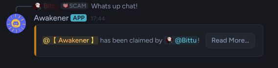
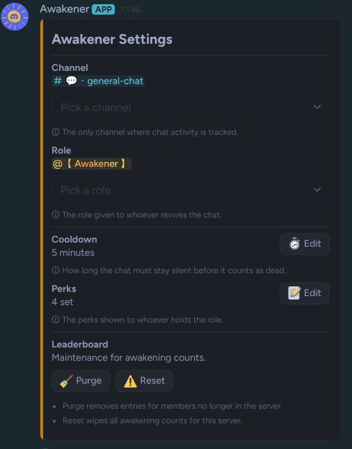
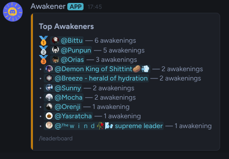

<div align="center">


# Awakener

**A chat-reviving Discord bot that crowns whoever wakes a silent channel.**


[](https://discord.com/oauth2/authorize?client_id=1561603393192067153&permissions=268504064&integration_type=0&scope=bot+applications.commands)
[](https://bittu.dev/discord/)

</div>

## How It Works

- The bot watches one channel in your server.
- When that channel goes quiet for longer than the cooldown, the chat is asleep.
- The **first person to speak** claims the Awakener role.
- If the chat goes silent again, the next person to wake it **takes the role** from them.
- Messages from the current holder just extend their hold and reset the timer.

## Quickstart

You can [invite the public bot](https://discord.com/oauth2/authorize?client_id=1561603393192067153&permissions=268504064&integration_type=0&scope=bot+applications.commands), or host it yourself:

```bash
# Installation
git clone https://github.com/Bittu5134/Awakener.git && cd Awakener
python -m venv .venv && source .venv/bin/activate
pip install -r requirements.txt

# Configuration
cp .env.example .env          # paste your DISCORD_TOKEN

# Start the bot
python main.py
```

Then run `/config` in your server to pick the channel and the role.

> [!IMPORTANT]
> The bot's role must sit **above** the Awakener role in **Server Settings → Roles**, otherwise Discord won't let it grant or remove the role.

> [!NOTE]
> Requires **Server Members Intent** enabled in the [Discord Developer Portal](https://discord.com/developers/applications).

### ENV Variables

- `DISCORD_TOKEN` — Discord bot token.
- `GUILD_ID` — Optional development guild ID for instant command syncing.
- `LOG_WEBHOOK_URL` — Optional webhook URL for error logging.

## Commands

- `/awaken` — show who currently holds the role.
- `/leaderboard` — top awakeners in the server, by total revivals.
- `/config` *(admin)* — pick the channel and role, set the cooldown, write the perks, reset or purge the leaderboard.

## Screenshots

<div align="center">



<br><br>

<table>
  <tr>
    <td align="center"><b>Settings</b></td>
    <td align="center"><b>Leaderboard</b></td>
  </tr>
  <tr>
    <td align="center" valign="top"></td>
    <td align="center" valign="top"></td>
  </tr>
</table>

</div>

## Built Using

[discord.py](https://github.com/Rapptz/discord.py) · [aiosqlite](https://github.com/omnilib/aiosqlite)
